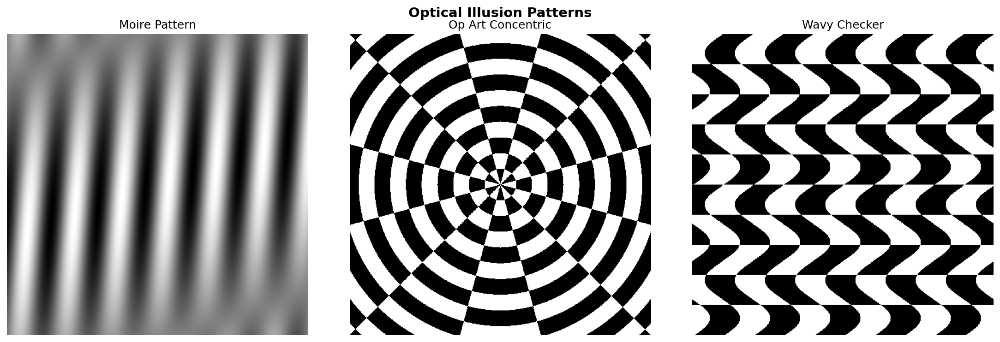
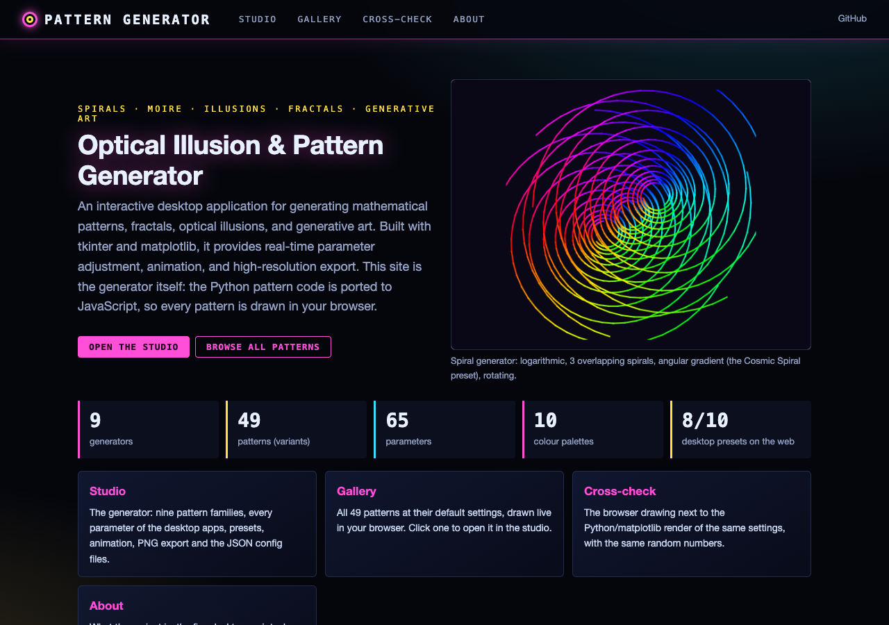
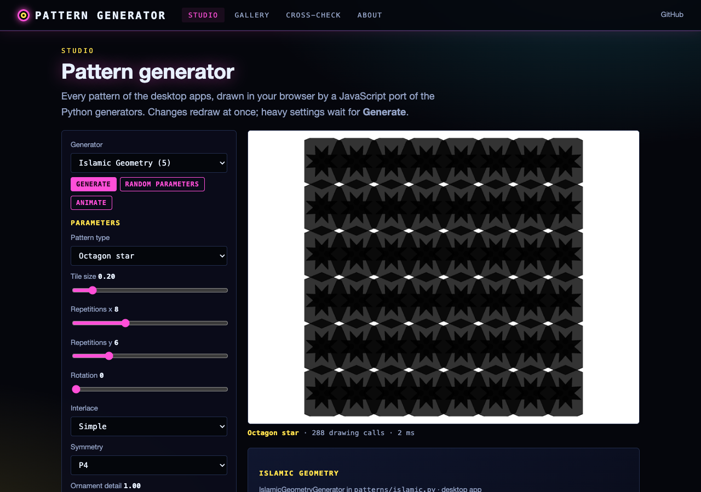
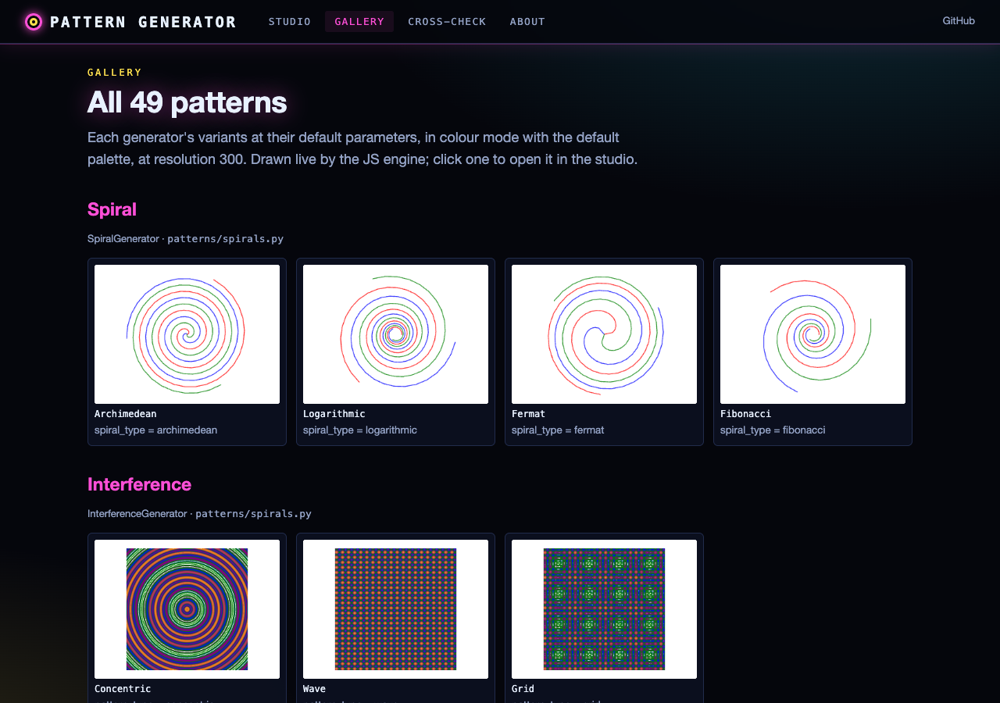
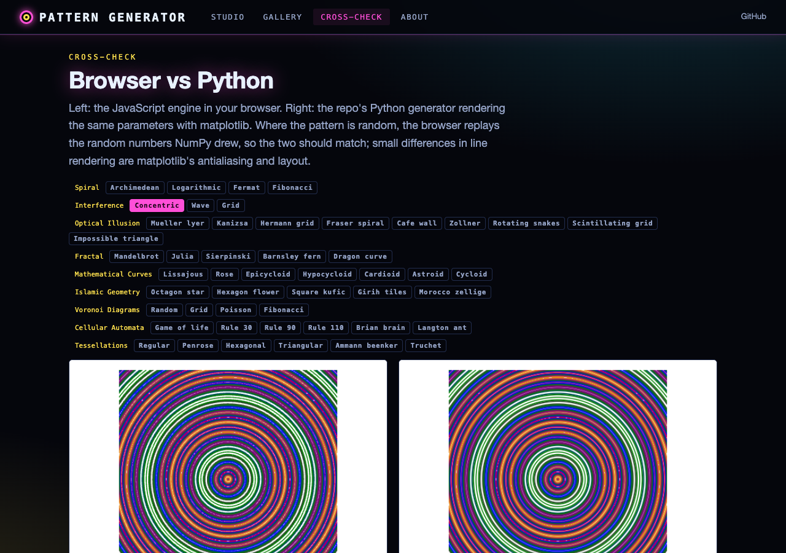

# Optical Illusion & Pattern Generator



An interactive desktop application for generating mathematical patterns, fractals, optical illusions, and generative art. Built with tkinter and matplotlib, it provides real-time parameter adjustment, animation, and high-resolution export.

## Features

### Pattern Categories

- **Spirals**: Archimedean, Logarithmic, Fermat, and Fibonacci (Golden) spirals with adjustable arms, density, overlapping spirals and radial/angular gradients
- **Interference**: Moire effects using concentric circles, waves, or grids
- **Optical Illusions** (V2): Hermann Grid, Scintillating Grid, Fraser Spiral, Cafe Wall, Zollner, Muller-Lyer, Kanizsa Triangle, Rotating Snakes, Impossible (Penrose) Triangle
- **Fractals** (V2): Mandelbrot and Julia sets, Sierpinski triangles, Barnsley Ferns, Dragon Curves
- **Mathematical Curves** (V2): Lissajous figures, Rose curves, Epicycloids, Hypocycloids, Cardioids, Astroids, Cycloids
- **Generative Art** (Advanced version): Islamic geometric patterns, Voronoi diagrams (with Lloyd relaxation), cellular automata (Game of Life, elementary rules 30/90/110, Brian's Brain, Langton's ant) and tessellations (regular, hexagonal, triangular, Truchet, and the aperiodic Penrose P3 and Ammann-Beenker rhomb tilings)

### Tools and Controls

- **Global Settings**: Resolution, line width, color mode (Black & White, Color, Gradient)
- **Animation Engine**: Animate patterns by cycling through rotation, phase, or other parameters
- **Quick Presets**: Instantly load configurations for Golden Spiral, Psychedelic, and other popular patterns
- **Export/Import**: Save and load pattern configurations as JSON
- **High-Resolution Export**: Save patterns as PNG or JPG (and SVG in the advanced version)

## Application Versions

| File | Description |
|------|-------------|
| `optical_illusion_generator_V2.py` | Expanded version with more illusions and improved UI |
| `enhanced_pattern_generator_V2.py` | Genetic-algorithm evolution, aesthetic scoring and multi-parameter animation, with simplified generative-art generators |
| `advanced_pattern_generator.py` | Full-featured "Mathematical Art Studio" with spirals, interference, Islamic geometry, Voronoi diagrams, cellular automata and tessellations |

The original `optical_illusion_generator.py` and `enhanced_pattern_generator.py` are superseded by their V2 versions and kept in `_archive/` (see its README). Each version builds on the previous, adding more pattern types and UI refinements. The `advanced_pattern_generator.py` is the most feature-rich for generative art; the optical illusions, fractals and mathematical curves are in `optical_illusion_generator_V2.py`.

## Architecture

The project uses an object-oriented design with clean separation between pattern generation and UI:

- **`PatternConfig`** (dataclass): Holds global visual settings (resolution, colors, line width)
- **`PatternGenerator`** (ABC): Abstract base class requiring `generate()` and `get_parameters()` methods. Each pattern type is a concrete subclass.
- **`OpticalIllusionApp`**: Main tkinter application managing the GUI event loop, parameter widgets, matplotlib canvas integration, animation, and file I/O

## Prerequisites

- Python 3.7+
- tkinter (included with most Python installations)

## Installation

```bash
pip install numpy matplotlib pillow scipy
```

`scipy` is only required for the advanced pattern generator (Voronoi tessellations).

## Usage

Run any version directly:

```bash
# Recommended: most feature-rich version
python advanced_pattern_generator.py

# Or the optical illusion focused version
python optical_illusion_generator_V2.py
```

1. **Select a Pattern**: Use the dropdown menu on the left to choose a category
2. **Adjust Parameters**: Tweak sliders and inputs in the Parameters frame
3. **Click Generate**: View the result in the main display area
4. **Try Presets**: Use Quick Presets buttons to load preconfigured patterns
5. **Animate**: Click the Animate button to cycle through parameter values
6. **Export**: Save the current pattern as an image or save the configuration as JSON

## Example Patterns

The generator can produce patterns including:
- Golden Spiral (Fibonacci spiral)
- Mandelbrot and Julia set fractals with custom color maps
- Moire interference patterns from overlapping grids
- Classic optical illusions (Hermann Grid, Cafe Wall, etc.)
- Lissajous curves and Rose curves
- Voronoi diagrams and Islamic geometric patterns
- Cellular automata and Truchet / hexagonal tessellations

## GUI Framework

Built with **tkinter** for the application shell and **matplotlib** (TkAgg backend) for pattern rendering via `FigureCanvasTkAgg`.

## Web interface

The generators also run in the browser: a JavaScript port of the Python pattern code draws every pattern on a canvas,
so the static site (GitHub Pages: https://gddickinson.github.io/optical_illusion_pattern_generator/) is the working
generator, with no server.

- **Studio**: all nine generators (Spiral, Interference, Optical Illusion, Fractal, Mathematical Curves, Islamic
  Geometry, Voronoi Diagrams, Cellular Automata, Tessellations; 49 patterns), every parameter, the global settings
  (colour mode, palette, resolution, line width, colours), 8 of the 10 desktop presets, random parameters, animation,
  PNG export and the desktop apps' JSON config files.
- **Gallery**: all 49 patterns at their defaults. **Cross-check**: the browser drawing next to the Python/matplotlib
  render of the same settings, replaying the same NumPy random numbers.






### Run the web app

```bash
pip install -r requirements-web.txt
python run_web.py            # http://127.0.0.1:8127
```

The local app adds *Render with Python* in the studio (any settings rendered by the real generator).
`python scripts/build_static.py` exports the static site to `site/`; `.github/workflows/pages.yml` publishes it on
every push to main (one-time setup: Settings -> Pages -> Source: GitHub Actions).

### Tests

```bash
python -m pytest -q tests/                 # generators, API, static build, fixtures, and the node engine test
node web/static/engine.test.mjs            # JS engine vs the Python generators (138 recorded cases)
```

`scripts/make_scene_fixture.py` records what the Python generators draw (and their random draws) into
`tests/fixtures/scenes.json`; the node test requires the JS engine to make the same drawing calls.
